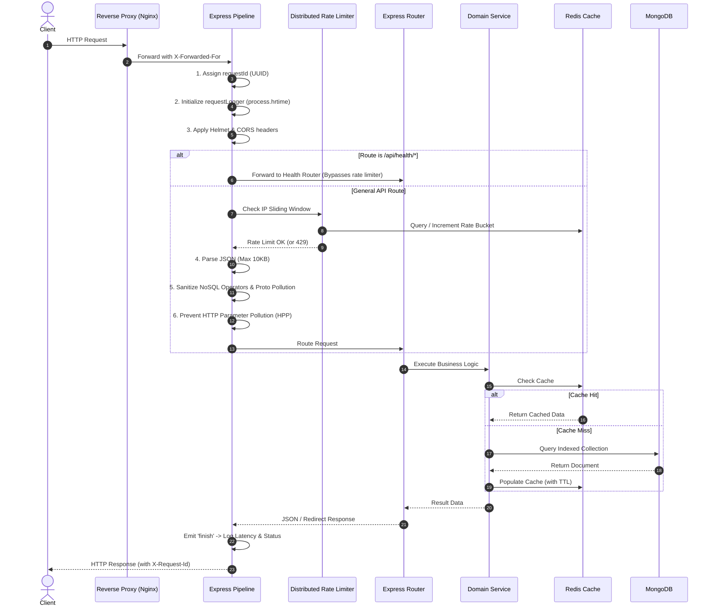
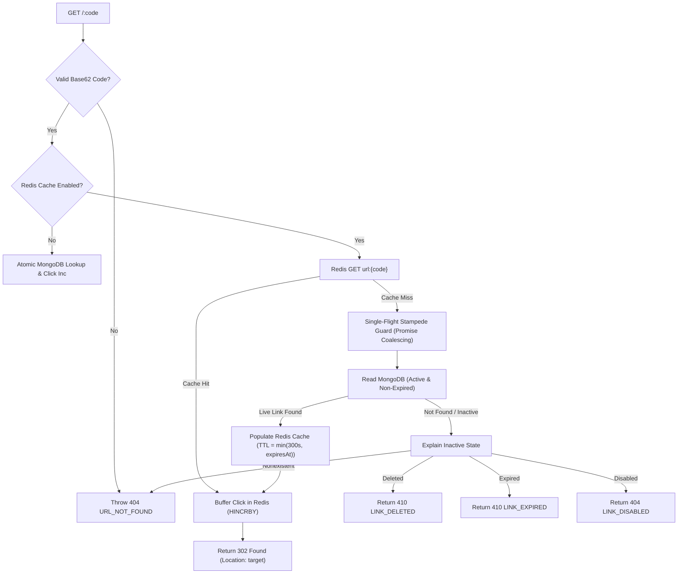
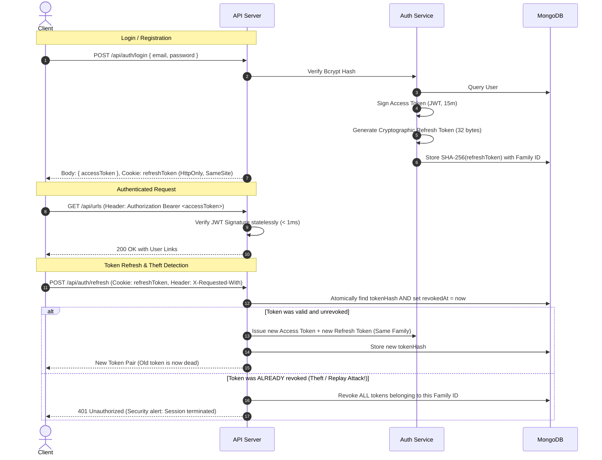

# System Architecture & Technical Specification

This document provides an exhaustive, engineering-grade technical specification of the **URL Shortener Platform**. It outlines the design patterns, data flows, database indexing strategies, concurrency models, caching mechanics, and security architectures implemented across the platform.

---

## 1. Architectural Philosophy

### Modular Monolith First
Rather than prematurely decomposing the application into complex distributed microservices (which introduces network latency, distributed transactions, and RPC operational overhead), the platform is structured as a **clean modular monolith**:
- **Single Process / Shared Memory**: Modules communicate via direct asynchronous JavaScript function calls rather than HTTP/gRPC hops.
- **Strict Separation of Concerns**:
  - `routes/`: Routing and HTTP protocol translation.
  - `middleware/`: Cross-cutting concerns (security, sanitization, rate limiting, logging).
  - `controllers/`: Parameter extraction, orchestration, and status code formatting.
  - `services/`: Core domain business logic, caching, and transaction coordination.
  - `models/`: Database persistence schemas, constraints, and indexes.
- **Independent Scalability**: The background worker process (`worker.js`) shares the codebase and data models with the API, but can be scaled independently as a dedicated container in Docker or Kubernetes.

---

## 2. Request-Response Lifecycle Flow

Every incoming HTTP request traverses a multi-layered middleware pipeline before reaching controller logic:



---

## 3. Database Schema Design & Indexing Strategy

### A. Url Collection (`server/models/url.model.js`)

| Field | Type | Modifiers | Purpose |
|---|---|---|---|
| `_id` | ObjectId | Auto, Primary Key | Unique document identifier |
| `user` | ObjectId | Ref: "User", Nullable | Owner of the link (null for anonymous creation) |
| `originalUrl` | String | Trimmed, Max: 2048 | Target destination URL |
| `shortCode` | String | Unique, Immutable | 7-character base62 slug or custom alias |
| `isCustomAlias` | Boolean | Default: false, Immutable | Distinguishes custom vs. random links |
| `status` | String | Enum: ["active", "disabled", "deleted"] | Lifecycle state |
| `clicks` | Number | Default: 0, Min: 0 | Total aggregated redirect visits |
| `lastClickedAt` | Date | Default: null | Timestamp of most recent visit |
| `expiresAt` | Date | Default: null | Optional link expiration cutoff |
| `createdAt` | Date | Auto Mongoose Timestamp | Creation audit timestamp |
| `updatedAt` | Date | Auto Mongoose Timestamp | Last mutation audit timestamp |

#### Compound Indexing & Query Optimization
```javascript
// Compound index for user link dashboard listing
urlSchema.index({ user: 1, createdAt: -1 });
```
- **Equality First, Sort Second (ESR Rule)**: Queries searching for all links owned by a user sorted by creation date (`{ user: actorId }`, sort: `{ createdAt: -1 }`) match this compound index perfectly. The database scans the B-tree directly without performing an expensive in-memory sort (`SORT_KEY_GENERATOR`).
- **Unique B-Tree on `shortCode`**: Enforces system-wide uniqueness at the storage engine level, acting as the absolute authority against race conditions.

---

## 4. Short-Code Generation & Collision Handling

The generation of short URLs balances high entropy, collision resistance, and vanity custom aliases:

### A. Base62 Generation
- Standard codes use a 62-character alphabet (`[0-9a-zA-Z]`).
- A 7-character code yields $62^7 \approx 3.52 \times 10^{12}$ (over 3.5 trillion) distinct combinations.
- Generated codes are sanitized against a **Reserved Word Blacklist** (`api`, `auth`, `admin`, `login`, `register`, `health`, etc.) to prevent collisions with API routing.

### B. Race Condition & Collision Strategy
Toy implementations query `findOne({ shortCode })` before `create()`. This introduces a classic **Time-of-Check to Time-of-Use (TOCTOU)** race condition: two concurrent requests can both see that code `abc1234` is free, and both attempt to insert it.

Our production implementation relies on the database unique index:
```text
1. Generate random 7-character code.
2. Attempt Url.create() inside try/catch.
3. If error code === 11000 (Duplicate Key Collision on shortCode):
   ├── If Random Code: Retry up to 5 times with a newly generated code.
   └── If Custom Alias:
       ├── If requested by the same owner with the same URL & expiry -> Return existing link (Idempotent 200).
       └── If requested by a different user or with different parameters -> Throw 409 Conflict (SHORT_CODE_TAKEN).
```

---

## 5. High-Throughput Redirection & Caching

The public redirect route (`GET /:code`) is the most performance-critical path in the entire system.



### A. HTTP 302 vs 301 Redirection
- **Why NOT 301 Moved Permanently?** Browsers cache `301` responses indefinitely in their local disk cache. Subsequent clicks from that user never reach our backend, completely breaking real-time click tracking and preventing users from updating destination links.
- **Why 302 Found?** Tells the client: *"This redirect is valid right now, but do not cache it."* We supplement this with:
  ```http
  Cache-Control: no-store, no-cache, must-revalidate, proxy-revalidate
  Pragma: no-cache
  Expires: 0
  ```

### B. Single-Flight Cache Stampede Protection
When a high-traffic link expires from cache, thousands of concurrent requests might hit the same short code at the same millisecond. If all of them fall back to MongoDB, the database experiences a **Cache Stampede / Thundering Herd** spike.

We resolve this using single-flight promise memoization:
```javascript
const inFlightReads = new Map();

function readLiveLinkOnce(code) {
  let pending = inFlightReads.get(code);
  if (!pending) {
    pending = Url.findOne(liveLinkFilter(code), ...).lean()
      .finally(() => inFlightReads.delete(code));
    inFlightReads.set(code, pending);
  }
  return pending; // All concurrent callers share the EXACT same database Promise
}
```

### C. Proportional Cache TTL Capping
Links with future expiration dates must not remain cached in Redis after their expiration passes. The cache TTL is dynamically calculated as:
$$\text{TTL} = \min(\text{DefaultTTL (300s)}, \text{expiresAt} - \text{now})$$
Ensuring that an expired link vanishes from cache precisely at its expiration second.

---

## 6. Asynchronous Click Batching (BullMQ & Redis)

Incrementing click counters in MongoDB on every redirect (`$inc: { clicks: 1 }`) causes severe write-lock contention under high concurrency.

### The Double-Buffering Pipeline
1. **Redirect Ingestion**:
   - The redirect handler executes an atomic Redis hash increment:
     ```redis
     HINCRBY click_buffer:pending <shortCode> 1
     ```
   - Execution time: **$< 1\text{ ms}$**. The HTTP redirect returns immediately without waiting for disk writes.
2. **Scheduled Batch Harvest**:
   - Every 10 seconds, the BullMQ scheduler fires the `flush-clicks` job.
   - Atomically swaps the active buffer to an isolated processing key:
     ```redis
     RENAME click_buffer:pending click_buffer:processing:<timestamp>
     ```
   - New clicks immediately accumulate in a fresh `click_buffer:pending` hash without blocking.
3. **Bulk Write to Database**:
   - Reads the entries from the processing hash.
   - Constructs an array of atomic bulk write operations:
     ```javascript
     const operations = Object.entries(counts).map(([code, count]) => ({
       updateOne: {
         filter: { shortCode: code },
         update: { $inc: { clicks: count }, $set: { lastClickedAt: now } },
         timestamps: false // Prevents bumping updatedAt on pure metric increments
       }
     }));
     await Url.bulkWrite(operations, { ordered: false });
     ```
   - Deletes the temporary processing key from Redis.

---

## 7. Dual-Token Authentication & Security Architecture



---

## 8. Failure Modes & High-Availability Resiliency Matrix

| Component Failure | System Behavior | Recovery Mechanism | User Impact |
|---|---|---|---|
| **Redis Crashes / Restarts** | System detects `client.status !== "ready"` and transparently degrades to direct MongoDB lookups and inline click increments. | Redis auto-reconnects with exponential backoff ($200\text{ ms} \dots 5000\text{ ms}$). | Zero downtime. Minor increase in redirect latency from $\sim 3\text{ ms}$ to $\sim 15\text{ ms}$. |
| **MongoDB Replica Failover** | Active pings in `/api/health/ready` fail with timeout. Readiness probe returns `503`. | Upstream load balancer removes instance from active pool until replica elections finish. | Inbound requests diverted to other nodes. No container restarts. |
| **Worker Process Dies** | API instances buffer clicks in Redis hash indefinitely. | Docker Compose / Kubernetes restarts worker container (`restart: unless-stopped`). | Zero click data lost; flushes resume immediately on boot. |
| **Node.js Process Crash** | Graceful shutdown coordinator catches `uncaughtException` / `unhandledRejection`, logs fatal error to Pino, and exits with code 1. | Container supervisor restarts process. | Transient connection dropped; remaining instances handle load. |

---

## 9. Observability & SRE Specifications

### Structured JSON Logging Schema
In production, standard output emits strict Newline-Delimited JSON (NDJSON) ingested by Fluentbit/Datadog:

```json
{
  "level": 30,
  "time": "2026-11-10T17:20:00.123Z",
  "service": "url-shortener",
  "env": "production",
  "requestId": "req_f4a9b2c8",
  "method": "POST",
  "path": "/api/urls",
  "status": 201,
  "latencyMs": 14.85,
  "ip": "192.168.1.1",
  "userAgent": "Mozilla/5.0 ...",
  "msg": "HTTP request completed"
}
```

### Automated Redaction Rules
Configured serializers replace sensitive paths with `[REDACTED]` before writing to stdout:
- `password`
- `*.password`
- `token`
- `*.token`
- `secret`
- `refreshToken`
- `req.headers.authorization`
- `req.headers.cookie`
