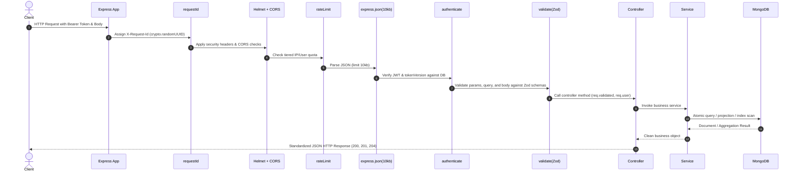
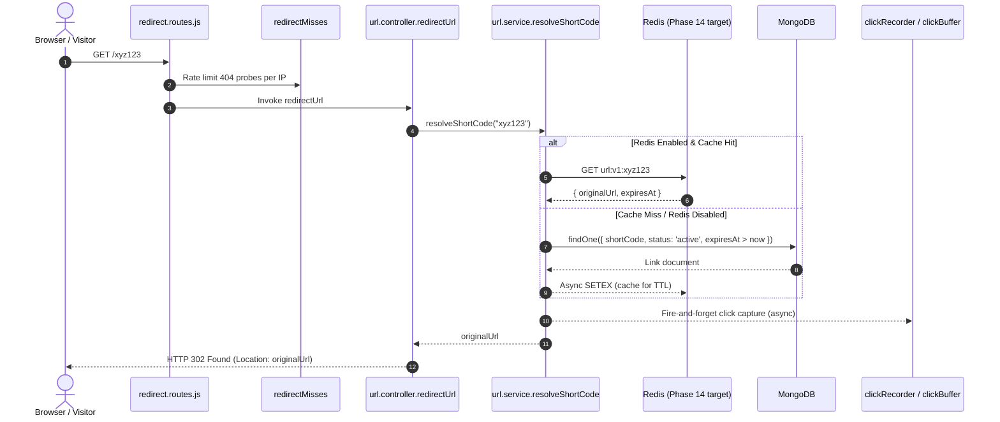

# URL Shortener Platform — Architecture & Codebase Audit (Phase 0)

**Date**: 2026-11-09  
**Repository**: `URL-SHORTNER-FULLSTACK`  
**Author**: Senior Backend Engineer & Software Architect  

---

## 1. Executive Summary & Current State

The repository is a full-stack, modular monolith URL shortener platform with a Node.js/Express backend and a React/Vite frontend.

### Milestone Progress Audit

| Phase | Description | Status in Git | Notes |
|---|---|---|---|
| **Phase 1** | Clean Modular Monolith Architecture | **Completed** (`ba948aa`) | Clear separation of routes, controllers, services, models, middleware |
| **Phase 2** | Request Validation (Zod) | **Completed** (`c7baecd`) | Strict schemas for body, query, and params with stripping of unknown fields |
| **Phase 3** | Production Error Handling | **Completed** (`0bfda40`, `c5ea487`) | Operational vs programming errors, RFC-style error structure with Request IDs |
| **Phase 4** | Database Design & Modeling | **Completed** (`7da9fc0`) | User, Url, RefreshToken, ClickEvent schemas with Mongoose |
| **Phase 5** | Database Indexes | **Completed** (`96902b8`) | Unique, compound (`{ user: 1, createdAt: -1 }`), and TTL indexes |
| **Phase 6** | Production URL Creation & Race Safety | **Completed** (`ea7f485`) | Atomic collision handling, reserved words check, idempotent replay |
| **Phase 7** | High-Performance Redirect Engine | **Completed** (`e6b653e`) | 302 redirects, atomic click increments, 410 Gone vs 404 Not Found handling |
| **Phase 8** | Authentication (JWT + Refresh Tokens) | **Completed** (`159b618`) | Dual-token authentication, bcrypt hashing with timing-attack prevention |
| **Phase 9** | Authorization & Access Control | **Completed** (`4438179`) | User vs Admin roles, IDOR protection baked into queries |
| **Phase 10** | Tiered Rate Limiting | **Completed** (`28ef144`) | Tailored windows for auth, link creation, redirects, and analytics |
| **Phase 11** | Real Dashboard API (CRUD + Pagination) | **Completed** (`28ef144`) | Keyset/deterministic pagination with tie-breaker, filtering, search |
| **Phase 12** | Frontend Dashboard (React + Vite) | **Completed** (`8d5839d`) | Debounced search, link management, token refresh interceptors |
| **Phase 13** | Privacy-Conscious Analytics Engine | **Completed** (`76b3ffe`) | MongoDB aggregation pipelines, user-agent parsing, TTL retention |
| **Phase 14** | Redis / Caching | **IN PROGRESS (Uncommitted)** | Files created but `ioredis` dependency uninstalled, causing test crashes |
| **Phase 15** | Background Jobs (BullMQ) | **IN PROGRESS (Uncommitted)** | Files created for click flushing & worker, but `bullmq` uninstalled |
| **Phases 16–25** | Hardening, Observability, Testing, Infra | **Pending** | Security review, structured logging, health checks, Docker, CI/CD |

---

## 2. Current Architecture & Folder Structure

```
URL-SHORTNER-FULLSTACK/
├── client/                     # Frontend (React 19 + Vite 8)
│   ├── src/
│   │   ├── api/                # Axios instance with auto-refresh interceptor
│   │   │   ├── http.js
│   │   │   ├── auth.js
│   │   │   └── urls.js
│   │   ├── components/         # Reusable UI components
│   │   ├── context/            # AuthContext (React Context)
│   │   ├── hooks/              # useLinks, useDebouncedValue
│   │   └── pages/              # Home, Login, Register, Dashboard
│   └── package.json
│
├── server/                     # Backend (Node.js + Express 5)
│   ├── config/                 # Environment validation and DB connections
│   │   ├── db.js
│   │   ├── env.js
│   │   └── redis.js            # [Uncommitted] Redis connection logic
│   ├── controllers/            # HTTP request/response orchestrators
│   │   ├── admin.controller.js
│   │   ├── analytics.controller.js
│   │   ├── auth.controller.js
│   │   └── url.controller.js
│   ├── jobs/                   # [Uncommitted] Background queues & workers
│   │   ├── clickFlush.job.js
│   │   ├── connection.js
│   │   └── index.js
│   ├── middleware/             # Express middlewares
│   │   ├── authenticate.js
│   │   ├── authorize.js
│   │   ├── errorHandler.js
│   │   ├── noStore.js
│   │   ├── notFound.js
│   │   ├── optionalAuthenticate.js
│   │   ├── rateLimit.js
│   │   ├── requestId.js
│   │   ├── requireCsrfHeader.js
│   │   └── validate.js
│   ├── models/                 # Mongoose schemas & database models
│   │   ├── clickEvent.Model.js
│   │   ├── refreshToken.model.js
│   │   ├── url.model.js
│   │   └── user.model.js
│   ├── routes/                 # Express route definitions
│   │   ├── admin.routes.js
│   │   ├── auth.routes.js
│   │   ├── redirect.routes.js
│   │   └── url.routes.js
│   ├── services/               # Pure business logic layer
│   │   ├── admin.service.js
│   │   ├── analytics.service.js
│   │   ├── auth.service.js
│   │   ├── clickBuffer.service.js # [Uncommitted]
│   │   ├── clickRecorder.js
│   │   ├── linkCache.service.js   # [Uncommitted]
│   │   ├── session.service.js
│   │   └── url.service.js
│   ├── utils/                  # Cryptography, tokens, errors, regex
│   ├── validators/             # Zod input validation schemas
│   ├── tests/                  # Built-in node:test test suite
│   ├── scripts/                # Database migrations & benchmark scripts
│   ├── app.js                  # Express app setup (middleware pipeline)
│   ├── server.js               # Entry point (HTTP server listen)
│   └── worker.js               # [Uncommitted] Standalone background worker entry
```

---

## 3. Current Backend Request Flow

### A. Management API Flow (`/api/urls`, `/api/auth`, `/api/admin`)


### B. High-Speed Redirect Hot Path (`GET /:shortCode`)


---

## 4. Current Database Design & Index Strategy

### Collections:
1. **`users`**:
   - Fields: `name`, `email` (unique, lowercase), `password` (hashed with bcrypt, `select: false`), `role` (`USER` | `ADMIN`), `tokenVersion` (for global revocation), `timestamps`.
   - Index: `{ email: 1 }` (unique).
2. **`urls`**:
   - Fields: `user` (ObjectId ref User), `originalUrl`, `shortCode` (unique, immutable), `isCustomAlias` (boolean), `status` (`active` | `disabled` | `deleted`), `clicks` (counter), `lastClickedAt` (Date), `expiresAt` (Date), `timestamps`.
   - Indexes:
     - `{ shortCode: 1 }` (unique) — primary redirect and creation collision check.
     - `{ user: 1, createdAt: -1 }` (compound) — dashboard listing queries.
3. **`refreshtokens`**:
   - Fields: `user` (ref User), `tokenHash` (SHA-256 unique), `family` (UUID for rotation breach detection), `expiresAt`, `revokedAt`.
   - Indexes:
     - `{ tokenHash: 1 }` (unique)
     - `{ user: 1 }`
     - `{ family: 1 }`
     - `{ expiresAt: 1 }` (TTL: `expireAfterSeconds: 0`)
4. **`clickevents`**:
   - Fields: `url` (ref Url), `clickedAt` (Date), `device` (desktop/mobile/tablet/bot/unknown), `browser`, `os`, `referrer`.
   - Indexes:
     - `{ url: 1, clickedAt: -1 }` (compound for time-filtered aggregations)
     - `{ clickedAt: 1 }` (TTL: auto-deletes events after `ANALYTICS_RETENTION_DAYS`)

---

## 5. Current Authentication & Authorization Flow

1. **Password Security**:
   - Salt rounds: 12 via `bcrypt`.
   - Timing attack mitigation: `verifyPassword` compares against `DUMMY_HASH` if the user is not found, maintaining constant execution time.
2. **Token Architecture**:
   - **Access Token**: Short-lived (15 minutes), signed JWT containing `{ sub: userId, role, tv: tokenVersion }`. Sent in `Authorization: Bearer <token>`.
   - **Refresh Token**: Long-lived (30 days), stored as opaque cryptographically random bytes inside an `httpOnly`, `sameSite=lax` cookie. Only its SHA-256 hash is saved in MongoDB.
3. **Token Rotation & Family Revocation**:
   - Each refresh invalidates the current refresh token and issues a new pair.
   - If an already-revoked refresh token is replayed, the entire token family is revoked immediately to prevent stolen token reuse.
4. **Authorization (IDOR Defense)**:
   - Resource access filters (`manageableBy`) enforce ownership directly in MongoDB queries:
     `{ _id: linkId, user: req.user._id, status: { $in: ['active', 'disabled'] } }`
   - Admins bypass the `user` filter, allowing global moderation.

---

## 6. Current Strengths

1. **Strict Layering**: Routes only route, controllers only handle HTTP representations, services contain business rules, and models define schema contracts.
2. **Deterministic Error Format**: All errors follow `{ success: false, error: { code, message, details }, requestId }`.
3. **Defense Against Common Attacks**:
   - NoSQL Injection prevented by Zod schema validation and explicit query casting.
   - XSS mitigated by Helmet and strict content sanitization.
   - CSRF on state-changing cookie requests mitigated by `X-Requested-With` header enforcement.
   - Timing attacks on auth prevented via constant-time dummy hashing.
   - IDOR prevented by database-level ownership filtering.
4. **Zero-PII Analytics**: No IP addresses or visitor cookies are retained in `ClickEvent`.

---

## 7. Current Weaknesses & Immediate Production Risks

### Critical Weaknesses:
1. **Broken Uncommitted State in Working Directory**:
   - `server/package.json` does NOT have `ioredis` or `bullmq` installed, but uncommitted files (`server/config/redis.js`, `server/services/linkCache.service.js`, `server/jobs/index.js`, `server/worker.js`) import them.
   - Running `npm test` currently **crashes** with `MODULE_NOT_FOUND: 'ioredis'`.
2. **Synchronous/Inline Background Processing**:
   - If Redis is absent, every redirect still executes MongoDB writes synchronously or semi-asynchronously without a resilient queue.
3. **Lack of Structured Logging**:
   - Current logs use raw `console.log` and `console.error` without standard levels, JSON formatting, or automated correlation with `X-Request-Id`.
4. **Incomplete Health Checks**:
   - `/api/health` only returns static `{ status: "ok" }`. It lacks Kubernetes-style liveness (`/api/health/live`) and readiness (`/api/health/ready`) checks verifying MongoDB and Redis connectivity.
5. **No Graceful Shutdown**:
   - `SIGTERM` and `SIGINT` are not trapped; in-flight requests or database connection pools can be terminated abruptly during deploys.
6. **No Containerization or CI/CD**:
   - No `Dockerfile`, `docker-compose.yml`, or GitHub Actions workflows exist yet.

---

## 8. Recommended Target Architecture

```
                                [ Cloudflare / Reverse Proxy / NGINX ]
                                                  │
                                                  ▼
                                      [ Docker Container ]
                               ┌────────────────────────────────┐
                               │       Node.js Express API      │
                               │  - Request ID & Structured Log │
                               │  - Helmet / Strict CORS / Rate │
                               │  - Zod Validation              │
                               │  - Graceful Shutdown Handlers  │
                               └────────┬──────────────┬────────┘
                                        │              │
                   Read / Invalidate    ▼              ▼  Queue Clicks & Buffers
                              ┌─────────────┐      ┌─────────────┐
                              │ Redis Cache │      │ Redis Queue │ (BullMQ)
                              └─────────────┘      └──────┬──────┘
                                                          │
                                                          ▼  Process batches
                                                   ┌──────────────┐
                                                   │ Worker Proc  │
                                                   └──────┬───────┘
                                                          │
                                                          ▼  Atomic bulkWrite
                                                   ┌──────────────┐
                                                   │   MongoDB    │
                                                   └──────────────┘
```

---

## 9. Remaining Implementation Roadmap (Phases 14 – 25)

Our path forward to production readiness:

- **Phase 14: Redis Caching Layer**  
  - Cleanly integrate `ioredis`. Implement link lookup caching with stampede protection (single-flight promise cache) and cache invalidation on link edit/delete.
  - Verification: `redirect-bench.js` and automated cache hit/miss tests.
  - Commit: `feat(cache): implement redis caching for short links with stampede protection`

- **Phase 15: Background Jobs & Workers (BullMQ)**  
  - Decouple click logging and analytics batching via BullMQ queue. Batch atomic `$inc` updates via worker jobs.
  - Verification: Worker execution test and bulk flush simulation.
  - Commit: `feat(jobs): implement bullmq click batching worker and schedulers`

- **Phase 16: Production Security Hardening**  
  - Audit CSP, HSTS, secure cookies, parameter pollution, and rate-limit distributed storage.
  - Verification: Security headers test and rate limit penetration test.
  - Commit: `feat(security): harden security headers, cookies, and attack mitigations`

- **Phase 17: Structured Observability & Logging**  
  - Replace `console.log` with a structured JSON logger (e.g., Pino) tagged with `requestId`, latency, status, and redaction of sensitive credentials.
  - Verification: Structured log format validation tests.
  - Commit: `feat(logging): integrate structured json logger with request correlation`

- **Phase 18: Liveness & Readiness Health Checks**  
  - Implement `/api/health/live`, `/api/health/ready`, verifying MongoDB and Redis socket status.
  - Verification: Health check route tests with active/mocked DB failures.
  - Commit: `feat(health): implement kubernetes-compliant liveness and readiness probes`

- **Phase 19: Graceful Shutdown System**  
  - Trap `SIGTERM` / `SIGINT`, close HTTP server, drain BullMQ workers, and close Redis/MongoDB connection pools cleanly.
  - Verification: Process shutdown simulation test.
  - Commit: `feat(infra): implement graceful shutdown for server and database pools`

- **Phase 20: Comprehensive Automated Testing Suite**  
  - End-to-end integration test suite covering auth, link creation, redirects, rate limiting, and analytics.
  - Verification: `npm test` reporting 100% passing tests.
  - Commit: `test(e2e): complete end-to-end integration and edge-case test suite`

- **Phase 21: Redirect Hot-Path Performance Optimization**  
  - Optimize `GET /:code` for sub-10ms response times: zero allocations, lean queries, connection pooling tuning.
  - Verification: Benchmark script showing throughput and latency numbers.
  - Commit: `perf(redirect): optimize redirect hot path and connection pooling`

- **Phase 22: Docker Multi-Stage Containerization**  
  - Production `Dockerfile` (non-root user, slim image) and `docker-compose.yml` (API, Worker, Mongo, Redis).
  - Verification: `docker compose up --build` verification.
  - Commit: `chore(docker): add production multi-stage dockerfile and docker-compose`

- **Phase 23: GitHub Actions CI/CD Pipeline**  
  - Automated PR checks (lint, audit, unit tests, integration tests) and main branch build validation.
  - Verification: GitHub Actions workflow syntax validation.
  - Commit: `ci: add github actions test and build workflow`

- **Phase 24: Production Deployment Guide & Configuration**  
  - Production environment checklist, HTTPS, reverse-proxy setup, and cloud deployment recipes.
  - Commit: `docs: add production deployment and environment runbook`

- **Phase 25: Final Architecture Documentation & Handover**  
  - Complete `ARCHITECTURE.md` showing final system design, component diagrams, and maintenance guidelines.
  - Commit: `docs: finalize architecture documentation and system blueprints`

---

## 10. Audit Conclusion & Next Step

The architecture built from Phases 1 through 13 is robust, scalable, and adheres to high engineering standards. However, the working directory was interrupted mid-way through Phase 14/15, leaving uncommitted files and missing dependencies that cause tests to fail.

The immediate next step is **Phase 14 — Redis / Caching Layer**:
1. Properly introduce and document `ioredis`.
2. Solidify `server/config/redis.js` and `server/services/linkCache.service.js`.
3. Wire cache reads into `server/services/url.service.js` with single-flight stampede protection.
4. Provide comprehensive unit & integration tests so `npm test` passes cleanly.
5. Provide the exact commit command.
