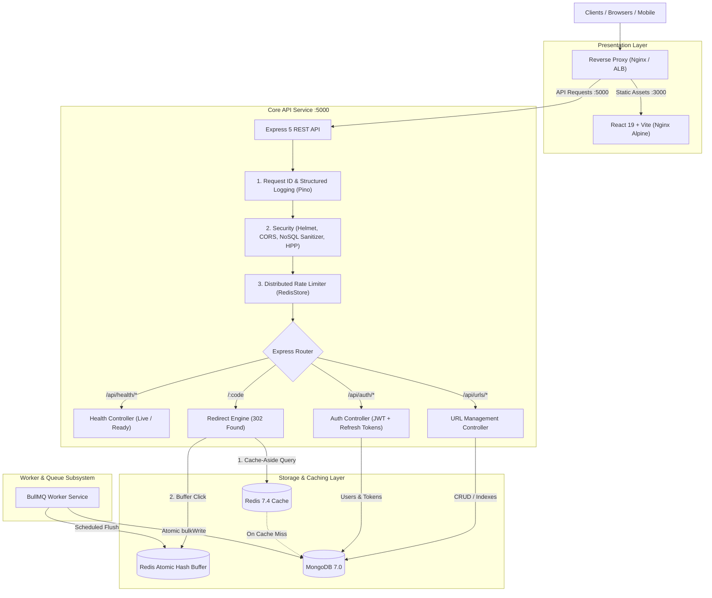

# Scalable Production URL Shortener Platform

An enterprise-grade, production-ready, full-stack URL shortening and analytics platform engineered with Node.js, Express, MongoDB, Redis, BullMQ, React 19, Vite, and Docker.

---

## Architecture Overview



---

## Key Engineering Highlights

1. **Modular Monolith Architecture**: Strict separation of concerns across Routes, Controllers, Services, Repositories, and Mongoose Models.
2. **High-Throughput Redirect Engine**:
   - `302 Found` non-permanent redirection preserves real-time click tracking while preventing aggressive browser caching.
   - Redis **Cache-Aside** architecture delivers sub-5ms link resolution.
   - **Single-Flight Cache Stampede Protection**: Coalesces concurrent cache misses for the same key into a single MongoDB lookup.
3. **Asynchronous Click Batching**:
   - Direct database writes on high-traffic redirects cause write-lock bottlenecks. Clicks are buffered into Redis hashes (`HINCRBY`) and flushed asynchronously in batches by a dedicated **BullMQ** worker via `Url.bulkWrite()`.
4. **Resilient Dual-Token Authentication**:
   - Short-lived Access Tokens (15 min) verified statelessly in memory.
   - Secure, `HttpOnly`, `SameSite` Refresh Tokens stored hashed (SHA-256) in MongoDB with **Family-Based Rotation & Automatic Theft Reuse Detection**.
5. **Defense-in-Depth Security**:
   - **NoSQL Injection Defense**: Recursive query sanitization stripping `$gt`, `$ne`, and `$where` operators.
   - **Prototype Pollution Prevention**: Strips `__proto__` and `constructor` keys from all JSON payloads.
   - **HTTP Parameter Pollution (HPP)**: Normalizes duplicated query parameters.
   - **Content Security Policy & Headers**: Powered by Helmet with strict script, frame, and transport directives.
   - **Custom CSRF Header Validation**: Enforces `X-Requested-With: XMLHttpRequest` for all cookie-authenticated state mutations.
   - **Distributed Rate Limiting**: Redis-backed sliding-window rate limiting with graceful fallback to memory.
6. **Observability & Health Checks**:
   - **Structured JSON Logging (Pino)**: High-resolution monotonic timers (`process.hrtime.bigint()`) and automated credential/PII redaction.
   - **Kubernetes-Grade Health Probes**:
     - `GET /api/health/live`: Fast process liveness probe.
     - `GET /api/health/ready`: Downstream dependency readiness check (MongoDB & Redis active pings with 2s timeouts).
     - `GET /api/health`: Diagnostic status reporting memory (`rssMb`, `heapUsedMb`) and service latency.
7. **Graceful Shutdown Coordinator**:
   - Listens for `SIGTERM` and `SIGINT`.
   - Fails readiness probes immediately to divert load balancer traffic.
   - Drains active keep-alive HTTP sockets, stops BullMQ queue consumers, and gracefully disconnects Redis and MongoDB pools with a 10s watchdog fallback.
8. **Containerization & Orchestration**:
   - Multi-stage Docker builds utilizing lightweight Alpine/Slim images and non-root users (`USER node`).
   - `docker-compose.yml` orchestrating 5 isolated services: `mongo`, `redis`, `api`, `worker`, and `client`.

---

## Tech Stack

| Layer | Technology | Version | Purpose |
|---|---|---|---|
| **Runtime** | Node.js | v22 LTS | Fast, modern asynchronous JavaScript execution |
| **Framework** | Express | v5.2 | Web framework with native async error handling |
| **Database** | MongoDB | v7.0 | Primary document datastore with compound indexes |
| **ODM** | Mongoose | v9.1 | Schema modeling, validation, and middleware |
| **Cache & Queue**| Redis & BullMQ | v7.4 / v6.7 | In-memory cache-aside, click buffering, and worker queues |
| **Logging** | Pino | v10.4 | Ultra-low overhead structured NDJSON logging |
| **Security** | Helmet, bcrypt, rate-limit-redis | Latest | Headers, password hashing, distributed throttling |
| **Frontend** | React, Vite, Nginx | v19 / Alpine | Reactive dashboard served via reverse proxy |
| **Testing** | Node Test Runner (`node:test`) | Built-in | Fast, zero-dependency unit, integration, and E2E tests |

---

## Directory Structure

```text
URL-SHORTNER-FULLSTACK/
├── client/                     # Frontend Single Page Application
│   ├── src/                    # React components, pages, hooks, API client
│   ├── nginx.conf              # SPA routing, gzip, and security headers
│   ├── Dockerfile              # Multi-stage build (Vite build -> Nginx Alpine)
│   └── package.json
├── server/                     # Backend API & Worker Service
│   ├── config/                 # Environment validation, logger, DB, Redis config
│   ├── controllers/            # Request handlers & response formatting
│   ├── middleware/             # Rate limiters, sanitize, HPP, auth, logging
│   ├── models/                 # Mongoose schemas (User, Url, RefreshToken)
│   ├── routes/                 # Express route definitions
│   ├── services/               # Core business logic (auth, url, cache, jobs)
│   ├── jobs/                   # BullMQ queue processors and schedulers
│   ├── utils/                  # Cryptography, tokens, errors, graceful shutdown
│   ├── validators/             # Request payload schemas
│   ├── tests/                  # 127 automated unit, integration, and E2E tests
│   ├── Dockerfile              # Node 22 slim image with dumb-init & non-root user
│   ├── app.js                  # Express app setup and middleware pipeline
│   ├── server.js               # HTTP server entry point with shutdown handler
│   └── worker.js               # Standalone queue worker entrypoint
├── docker-compose.yml          # Full multi-container orchestration (5 services)
├── ARCHITECTURE_AUDIT.md       # Initial legacy codebase audit & roadmap
├── ARCHITECTURE.md             # Deep-dive system architecture specification
└── README.md                   # Platform documentation & operational runbook
```

---

## Quickstart Guide

### Option 1: Running with Docker Compose (Recommended)

To launch the complete platform (Database, Cache, API, Queue Worker, and Frontend) in production-ready containers:

```powershell
docker compose up --build -d
```

Verify the stack health:
```powershell
docker compose ps
```

Access the services:
- **Frontend UI**: [http://localhost:3000](http://localhost:3000)
- **REST API & Health**: [http://localhost:5000/api/health](http://localhost:5000/api/health)
- **MongoDB**: `localhost:27017`
- **Redis**: `localhost:6379`

To view consolidated structured logs:
```powershell
docker compose logs -f api worker
```

To stop the containers gracefully:
```powershell
docker compose down
```

---

### Option 2: Running Locally for Development

#### 1. Prerequisites
- Node.js 20+ installed
- MongoDB and Redis running locally (or via Docker)

#### 2. Start Backend API
```powershell
cd server
npm install
npm run dev
```

#### 3. Start Backend Worker (in a separate terminal)
```powershell
cd server
npm run worker
```

#### 4. Start Frontend Client (in a separate terminal)
```powershell
cd client
npm install
npm run dev
```

---

## Environment Variables Configuration

Create a `.env` file in `server/` (or configure in `docker-compose.yml`):

| Variable | Type | Default | Description |
|---|---|---|---|
| `PORT` | Number | `5000` | Port for the Express HTTP server |
| `NODE_ENV` | String | `development` | Environment mode (`development`, `production`, `test`) |
| `MONGO_URI` | String | *Required* | MongoDB connection URI (`mongodb://localhost:27017/url-shortener`) |
| `REDIS_URL` | String | Optional | Redis connection URL (`redis://localhost:6379`). If omitted, caching is gracefully disabled |
| `BASE_URL` | String | `http://localhost:5000` | Fully-qualified public domain prefix for generated short links |
| `CLIENT_URL` | String | `http://localhost:3000` | Allowed CORS origin for frontend single page application |
| `JWT_SECRET` | String | *Required* | Secret key for signing Access Tokens (minimum 32 characters) |
| `ACCESS_TOKEN_EXPIRES_IN`| String | `15m` | Lifetime of stateless Access Tokens |
| `REFRESH_TOKEN_DAYS` | Number | `30` | Expiration window for refresh tokens in days |
| `CACHE_TTL_SECONDS` | Number | `300` | Redis link cache TTL in seconds (5 minutes) |
| `CLICK_FLUSH_INTERVAL_SECONDS`| Number | `10` | Frequency in seconds at which buffered clicks flush to MongoDB |
| `JOBS_MODE` | String | `inline` | `inline` (run jobs inside server process) or `off` (run in dedicated worker process) |
| `TRUST_PROXY` | Number/Bool | `1` | Reverse proxy hop count for accurate IP extraction |

---

## API Reference Guide

### 1. Health & Probes
- `GET /api/health/live`: Fast process liveness probe. Returns `200 OK`.
- `GET /api/health/ready`: Dependency readiness probe. Returns `200 OK` when MongoDB is connected; `503 Service Unavailable` when downstream dependencies fail.
- `GET /api/health`: Diagnostic report containing system uptime, memory allocation, and database latencies.

### 2. Authentication
- `POST /api/auth/register`: Register account (`name`, `email`, `password`). Returns access token and sets `refreshToken` cookie.
- `POST /api/auth/login`: Authenticate credentials (`email`, `password`). Returns access token and sets `refreshToken` cookie.
- `GET /api/auth/me`: Fetch authenticated user profile (`Authorization: Bearer <token>`).
- `POST /api/auth/refresh`: Rotate refresh token and obtain a new access token (Requires `Cookie` and `X-Requested-With: XMLHttpRequest`).
- `POST /api/auth/logout`: Revoke active session and clear cookie.
- `POST /api/auth/logout-all`: Invalidate all active user sessions globally by incrementing `tokenVersion`.

### 3. URL Management
- `POST /api/urls`: Create a shortened URL. Accepts `originalUrl`, optional `customCode`, and optional `expiresAt`.
- `GET /api/urls`: List user's links with pagination (`?page=1&limit=10&sort=createdAt&order=desc&search=term`).
- `GET /api/urls/:id`: Retrieve details and metrics for an individual link.
- `PATCH /api/urls/:id`: Update destination URL, expiration date, or status (`active` / `disabled`). Automatically purges Redis cache.
- `DELETE /api/urls/:id`: Soft-delete short link (`status: "deleted"`). Immediately renders code `410 Gone`.

### 4. Public Redirection Engine
- `GET /:code`: Public resolution endpoint.
  - Returns `302 Found` with target in `Location` header.
  - Sets `Cache-Control: no-store, no-cache, must-revalidate`.
  - Automatically records visitor analytics and buffers click increments.
  - Returns `410 Gone` if expired or deleted; returns `404 Not Found` if nonexistent.

---

## Automated Test Suite

The platform includes 127 automated tests executed via the native Node.js test runner (`node:test`):

```powershell
npm --prefix server test
```

Test coverage includes:
- **Unit Validation**: Schemas, custom code rules, regex sanitization, reserved word blacklists.
- **Security Tests**: NoSQL injection operator stripping, prototype pollution resistance, HPP prevention, payload size limits.
- **Database & Cache**: Compound index explain plans, cache-aside populate/invalidate, stampede coalescing.
- **Background Jobs**: Atomic Redis hash click buffering, BullMQ schedulers, bulk write updates.
- **Graceful Teardown**: Signal trapping (`SIGTERM`/`SIGINT`), readiness probe draining, socket teardown.
- **End-to-End User Flow**: Full HTTP integration from registration, authentication, link creation, redirection, updating, token refreshing, to deletion.

---

## Production Deployment Runbook

### Pre-Deployment Checklist
1. Generate a cryptographically secure `JWT_SECRET` ($\ge 32$ characters).
2. Set `NODE_ENV=production`.
3. Set `COOKIE_SECURE=true` (requires HTTPS).
4. Configure `JOBS_MODE=off` in API containers, and run `worker.js` in a dedicated container.
5. Set `TRUST_PROXY=1` (or your load balancer hop count) to ensure accurate client IP rate limiting.

---

## License

This project is licensed under the ISC License.
